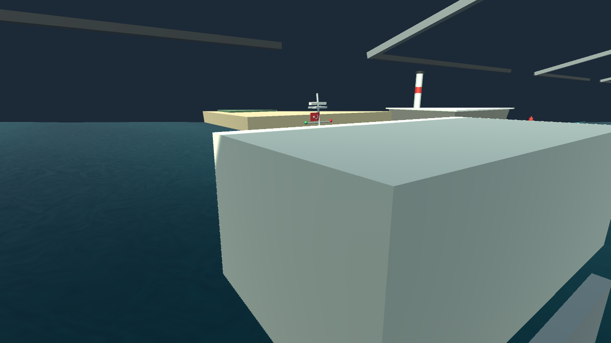

# Meridian

Türk Deniz Kuvvetleri gemilerinden esinlenen, mobil hedefli bir **gemi kumanda ve manevra oyunu**. Oyuncu bağımsız makineleri, dümeni ve ANADOLU'da liman römorkörlerini kullanarak gemiyi yönetir.

**Durum:** oynanabilir Unity Editor prototipi. Yayına hazır ürün, foto-gerçekçi gemi modeli veya sertifikalı seyir/eğitim simülatörü değildir.

## Teknoloji ve çalıştırma

- **Unity 6.6 — 6000.6.6f1**, C# ve Unity Rigidbody fiziği.
- Kodla oluşturulan gemi/liman modelleri, özel su ve köpük shader'ları, parçacık efektleri.
- Fare/klavye ve mobil dokunma kontrolleri. Projede iOS build profili bulunur; gerçek cihaz doğrulaması ve mağaza paketleri henüz tamamlanmamıştır.
- Proje ölçeği: **1 Unity birimi = 4 metre**. Sürat göstergeleri bu ölçekten knot'a çevrilir.

1. Depoyu klonla: `git clone https://github.com/malibu61/meridian.git`.
2. Unity Hub → **Add/Open project** ile `meridian` klasörünü seç.
3. Uyumlu Editor ile aç; paketlerin ve kaynakların içe aktarılmasını bekle.
4. `Assets/Scenes/Main.unity` sahnesini açıp **Play** düğmesine bas.
5. Gemi, seyir modu ve deniz koşullarını seç; **SEYRİ BAŞLAT**.

Unity Remote görüntüsü, telefonda çalışan bağımsız bir iOS build'i değildir; gerçek cihaz kalite/performans değerlendirmesi ayrıca yapılmalıdır.

## Gemiler

| Platform | Kumanda | Oyundaki tam ileri sürat hedefi |
| --- | --- | --- |
| TCG BARBAROS — F-244 | İki bağımsız makine + dümen | 32 kn |
| TCG ANADOLU — L-400 | İki pod için basitleştirilmiş kumanda + römorkör desteği | 21 kn |
| TCG RÜZGAR — P-344 | Dört bağımsız makine + kompakt dümen/ortak gaz | 41 kn |
| TCG KUMKALE — P-1203 | İki bağımsız makine + dümen | 25 kn |

Bunlar oyunun sürat hedefleridir; gerçek gemilerin her deniz/yük koşulundaki performansı iddia edilmez. Dönüş çapı, hızlanma, yalpa ve römorkör kuvvetleri indirgenmiş oyun modelleriyle ayarlanmıştır.

BARBAROS'ta S-70B helikopteri, hareketli baş/kıç güverte ekipleri ve köprüüstü/kırlangıç vardiyası bulunur. ANADOLU'nun geniş uçuş güvertesi, ada üst yapısı ve park edilmiş helikopteri; küçük gemilerin ise farklı gövde, üst yapı ve ekipman düzenleri vardır. Modeller kamuya açık fotoğraflara dayanan özgün görsel çalışmalardır, tersane CAD modelleri değildir.

## Oynanabilir modlar

- **Gemi Yanaştırma:** örnek limanda serbest manevra. ANADOLU'da hedef rıhtım seçimi ve iki bağımsız römorkör vardır.
- **Boğaz Geçişi:** Çanakkale Boğazı'nın kuzeyinden güneyine ilerleyen, 12 sıralı kontrol noktalı ayrı prototip; rota krokisi, köprü ve kıyı silüetleri.
- **Şamandıraya Bağlama:** menüde yer tutucu; henüz oynanabilir değildir.

**MENÜ / Esc** simülasyonu duraklatır. **MEVCUT SEYRE DEVAM** mevcut seferi sürdürür; yeni seyir geminin konumunu, makineleri, dümeni ve efektleri sıfırlar.

## ANADOLU: römorkörlü yanaşma

Bu özellik **yalnız ANADOLU + Gemi Yanaştırma** seçiliyken açılır.

1. Liman kontrol penceresinde **doğu rıhtımı / sancak aborda** veya **batı rıhtımı / iskele aborda** seçilir.
2. Turkuaz çerçeve hedefi gösterir. İleri/tornistan ve dümen hâlâ oyuncunun kontrolündedir.
3. Römorkör üzerindeki işarete veya **BAŞ İT / KIÇ İT** kartına tıklanır/dokunulur.
4. Römorkör temasa yaklaşır ve kuvveti kademeli artırır. Tekrar tıklamak ilgili komutu, **İKİSİ DUR** iki komutu da keser.

Sancağa itmek için iskeledeki, iskeleye itmek için sancaktaki römorkörler kullanılır. İki eşit kuvvet yanal harekete; yalnız baş veya kıç römorkörü ise dönüşe de katkı verir. Geminin hareketi gerçek Rigidbody kuvvetiyle oluşur, transform ile gemi kaydırılmaz.

- Destek limana yaklaşırken de çalışır; son rıhtıma yakınlık şartı yoktur.
- İtme için baş **000° ±30°**, sürat **5 kn altında** olmalıdır; tam destek **2 kn ve altında** verilir.
- Temas yokken veya menü/hedef penceresi açıkken kuvvet uygulanmaz.
- Panelde gerçekten uygulanan itme yüzdesi ve **YAN ←/→ … kn** yanal sürat gösterilir. Oklar yalnız kuvvet uygulanırken çizilir.
- Römorkörlerin kendi intikali basitleştirilmiştir; halatla çekme ve genel liman engelinden kaçınma henüz yoktur.

[Araştırma, kullanım, fizik ve test sonuçları](docs/ANADOLU_ROMORKOR.md).

## Kumanda ve arayüz

- İleri **10 kademe**: +10…+100%; tornistan **5 kademe**: −20…−100%; ayrı STOP konumu.
- Yüzdelik çizgiler, sayısal etiketler ve tüm makineleri birlikte ayarlayan **ORTAK GAZ**.
- Yalnız RÜZGAR'da iki solda, iki sağda dört bağımsız kol; daha küçük merkezî kumandalar.
- Anlık sürat, baş, rota, makine durumu, sayısal ve **±40° analog yalpa göstergesi**.
- Ekran güvenli alanına ölçeklenen ortak koyu arayüz.

| PC girişi | İşlev |
| --- | --- |
| W / S | Tüm makineleri kademe kademe ileri / tornistan ayarla |
| Q / A | İskele makine; RÜZGAR'da dış iskele |
| E / D | Sancak makine; RÜZGAR'da dış sancak |
| Z / X, C / V | Yalnız RÜZGAR: iç iskele, iç sancak |
| ← / →, ↓ | Dümen, dümeni ortala |
| Space | Makine komutlarını sıfırla; gemi anında durmaz |
| Fareyle sürükle | Kumandalar dışındaki alanda kamerayı geminin etrafında döndür |
| Tekerlek, + / −, R | Yakınlaş/uzaklaş, başlangıç kadrajına dön |

Mobilde tek parmak kamera dönüşü, iki parmak açma/birleştirme zoom ve dokunmatik kumandalar bulunur. Kamera hareketi kumanda panelleri üzerinde başlamaz.

## Deniz ve hareket

- Menüde **5 oyun dalga seviyesi** ve 8 pusula geliş yönü; mevcut seyirde koşulları değiştirme.
- Geometrik dalga yüzeyi, hareketli küçük su detayları, baş köpüğü, pervane izi, kıyı yıkaması ve borda sıçramaları.
- Dalgalardan yalpa, baş-kıç, düşey hareket ve yatay kuvvet/rota etkisi.
- Dümen geçiş süresi, gecikmeli dönüş çemberi, dönüşte dışa yatış ve gemiye göre farklı sürat/tepki.
- Makine yüküyle artan egzoz; ani gaz açmada kısa süreli koyulaşan duman.

**Dalga seviyeleri standart bir deniz durumu/Beaufort ölçeği değildir.** Su-gövde etkileşimi tam akışkan ve deplasman hesabı içermez; dalganın güverteyi kesmesi gibi görsel/fiziksel eksikler devam eder.

## Doğrulama ve bilinen sınırlar

22 Ekim 2026 tarihli kayıtlar:

- Küçük gemi geometrisi **7.949**, model çalışma zamanı **150** kontrol.
- Dört makine kumandası **515** mantık ve **69** çalışma zamanı kontrolü.
- Sürat/dönüş/yalpa: **39 fizik senaryosu, 89 kontrol**.
- Römorkörler: **747 kural/gövde/yerleşim**, **56 entegrasyon kontrolü ve 6 fizik senaryosu**.
- Ayrı Unity PhysicsScene deneylerinde üretimdeki kuvvet yolu kullanıldı. Römorkörlerle 30 saniyede yaklaşık **6,1 m** yanal hareket ve baş/kıç için zıt dönüş momentleri ölçüldü.
- PC'de rıhtım seçimi, it/dur komutları ve canlı yanal sürat kontrol edildi. Bu kayıtlar gerçek iPhone/Metal/multitouch performans testi yerine geçmez.

[Doğrulama kayıtları](docs/testing/) ve Editor'deki `Meridian/…Review` araçları ayrıntıları içerir. İnceleme araçları istek üzerine çalıştırılır; bazı eski kaynak kontrolleri Editor açılışında da rapor üretir.

Bilinen eksikler:

- Mevcut `VesselSelectionReview`, ANADOLU gövde kapaklarında kenar yönü tutarsızlığı raporluyor; bu nedenle bütün proje kontrolleri yeşil değildir.
- Oyun açıkken kaynak yeniden derlenmesi gemi tanımı/görsel eşleşmesini bozabilir. Şüpheli durumda Play'i durdurup yeni sefer başlat.
- Çanakkale coğrafyası taslak; gerçek OSM/DEM verisi ve akıntı sistemi uygulanmadı.
- Foto-gerçekçilik, tam gemi hidrodinamiği, gerçek cihaz optimizasyonu ve mağaza hazırlığı tamamlanmadı.
- Puanlı ortak görev sistemi, şamandıra bağlama ve halat fiziği henüz yoktur.

## Sıradaki adım: görev senaryoları — öneri, henüz uygulanmadı

Serbest manevranın üzerine kısa, ölçülebilir görevler eklenmesi planlanabilir:

1. **Temel liman girişi:** giriş kapılarından sırayla geç, sürat sınırını koru, hedef alanda dur.
2. **ANADOLU römorkörlü yanaşma:** verilen rıhtıma baş açısı, mesafe ve düşük yanaşma sürati koşullarını sağlayarak yerleş.
3. **Boğaz geçişi:** kontrol noktalarını tamamla; rota dışına çıkma ve sürat ihlallerini değerlendir.
4. **İleri aşama:** sert hava, kısıtlı görüş, tek makine arızası ve şamandıra bağlama.

Önerilen görev yapısı: kısa brifing → hedef işareti → anlık hedef/uyarılar → başarı/başarısızlık → süre, temas ve hassasiyete göre değerlendirme. Bu bölüm yol haritasıdır; mevcut oynanabilir özelliklerle karıştırılmamalıdır.

## Belgeler

- [Ana geliştirme kaydı ve ilk MVP](docs/ILK_MVP_TASARIMI.md)
- [BARBAROS görsel incelemesi](docs/BARBAROS_GORSEL_INCELEME.md)
- [Güverte yaşamı ve S-70B](docs/GUVERTE_YASAMI.md)
- [PC/mobil kamera ve zoom](docs/KAMERA_ZOOM.md)
- [Makine yüküne bağlı duman](docs/BACA_DUMANI.md)
- [Modlar ve Boğaz Geçişi](docs/MODLAR_VE_BOGAZ_GECISI.md)
- [Kumanda ve arayüz](docs/KUMANDA_VE_ARAYUZ.md)
- [Deniz ve köpük](docs/DENIZ_VE_KOPUK.md)
- [Dalga seçimi ve gemi fiziği](docs/DALGA_SECIMI_VE_GEMI_FIZIGI.md)
- [Borda çarpması ve dalga düzeltmeleri](docs/DALGA_CARPMA_VE_DUZELTMELER.md)
- [Analog yalpa kadranı](docs/YALPA_KADRANI.md)
- [RÜZGAR ve KUMKALE](docs/RUZGAR_VE_KUMKALE.md)
- [Sürat, dönüş ve yalpa fiziği](docs/SURAT_DONUS_YALPA.md)
- [ANADOLU römorkörleri](docs/ANADOLU_ROMORKOR.md)
