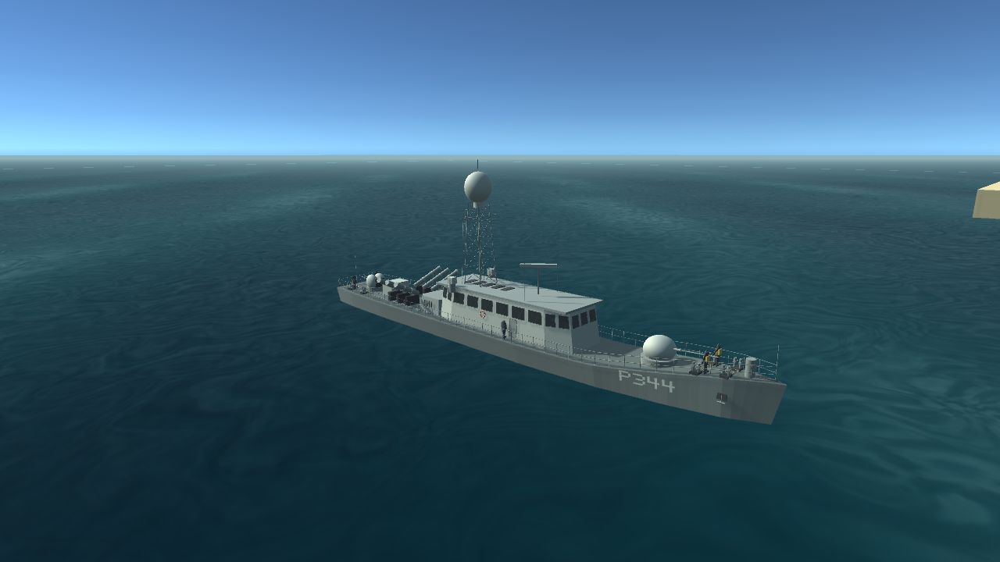
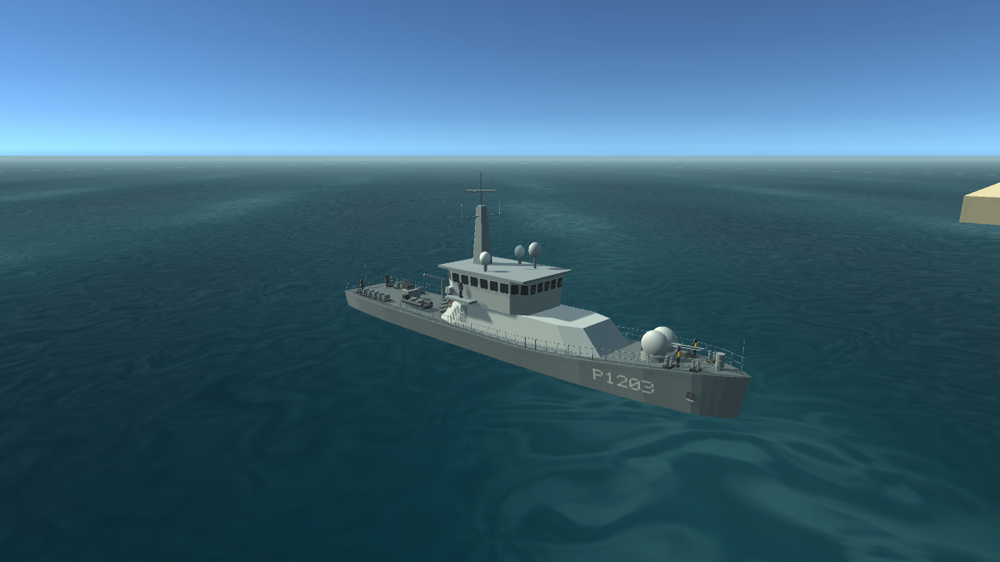

# TCG RÜZGAR ve TCG KUMKALE — model, kumanda ve test kaydı

Güncelleme: 22 Ekim 2026. Aktif proje: `C:/Users/Muhammet Ali/source/repos/malibu61/meridian`.

Bu sürüm kamuya açık fotoğraflarla oranlanmış, mobil oyuna yönelik prosedürel dış modellerdir. Tersane modeli, güncel askerî donanım doğrulaması veya foto-gerçekçi Blender/UV/PBR üretimi değildir. Görünmeyen alt gövde, pervaneler, şaft aralıkları, kapılar ve küçük donatılar yaklaşık yorumdur.

## İki ayrı gemi

| Özellik | TCG RÜZGAR | TCG KUMKALE |
|---|---|---|
| Kimlik | P-344, Rüzgar sınıfı hücumbot | P-1203, Tuzla sınıfı karakol gemisi |
| Oyun modelinin boy/en oranı | 57,84 / 7,62 m | 56,90 / 8,90 m |
| Gövde | Dar, alçak borda, ince baş | Daha dolgun ve yüksek baş, geniş gövde |
| Üst yapı | Uzun/alçak köprüüstü; kafes direk ve büyük yuvarlak radom | Eğimli kapalı üst yapı; geniş köprüüstü ve kapalı sensör direği |
| Ayırt edici görünüm | Başta 76 mm, kıçta çift 35 mm görünümü, eğimli altı kapalı kanister | Çift namlulu 40 mm baş topu görünümü, kıç çalışma sahası, bot ve vinç |
| Kumanda | Dört bağımsız makine | İki bağımsız makine |

Kapalı ve dışa dönük gövde/deck/üst yapı yüzeyleri; opak pencere camları, pencere çerçeveleri ve silecekler; iki bordada gövdeye oturan, aynalanmayan numaralar oluşturuldu. Bot, kapılar, can simitleri, korkuluklar, babalar, halat kangalları, demir donatısı, antenler ve bayrak vardır. Her gemide altı animasyonlu güverte personeli bulunur. Bunlar mevcut Barbaros modelinin küçültülmüş kopyaları değildir.

Hareketli radar, pervane ve dümenler bağımsızdır. Statik parçalar malzemelerine göre birleştirilir. İlk ölçümde RÜZGAR 108, KUMKALE 100 aktif mesh renderer ile çalıştı; yeni gemilerde önceki fırkateynin personel/heykel sayısı taşınmadı. Kamera mesafesi, çarpışma gövdesi, baş/kıç köpüğü, borda sıçraması ve egzoz konumları gemiye göre ayarlanır.

## Yalnız hücumbotta dört kol

Solda dış iskele ve biraz daha küçük iç iskele; sağda iç sancak ve dış sancak vardır. İç/dış kollar gerçekten farklı şaftların komutlarıdır. Ortada küçültülmüş dümen ve ortak gaz, bir grup olarak ekran merkezine yerleşir. KUMKALE, BARBAROS ve ANADOLU eski iki kollu düzeni korur.

- İleri: 10 kademe, +10…+100%. Tornistan: 5 kademe, −20…−100%. Nötr: STOP.
- Ortak gaz aktif gemideki bütün makineleri eşitler; kalıcı bağlantı oluşturmaz. Herhangi bir kol ayrı değiştirilirse dört komutun tamamı karşılaştırılarak AYRI gösterilir.
- Ortak gaz tutulurken dört ayrı makine dokunuşu bırakılır; dümenin ayrı parmağı korunur. İç kollar kamera sürükleme alanına dahil edilmez.
- Acil stop bütün makine komutlarını sıfırlar. Gemi hızını, gerçek makine yükünü veya dümeni aniden sıfırlamaz.
- `W/S`: tüm makinelerin kademesi. `Q/A`: dış iskele. `E/D`: dış sancak. Yalnız RÜZGAR’da `Z/X`: iç iskele, `C/V`: iç sancak. Oklar: dümen. `Space`: acil stop.
- Gemi değişince bütün komutlar, iç makine yükleri, dümen, dokunma sahipliği ve efektler temizlenir.

## Araştırma kaynakları ve sınırlar

- [Dearsan PV57 ürün sayfası ve fotoğraf galerisi](https://www.dearsan.com/urun/pv57/): üreticinin Tuzla ailesi için boy/en ve sınıf gövde/üst yapı referansı. Galerideki her gemi P-1203 değildir; kardeş gemi donanımları KUMKALE’ye kesin olarak atfedilmedi.
- [TRT Haber / Anadolu Ajansı — KUMKALE ziyaret fotoğrafları](https://www.trthaber.com/haber/turkiye/tcg-kumkale-gemisi-lapsekide-ziyarete-acildi-798262.html): özellikle P-1203 numarası, baş eğimi ve köprüüstü camları.
- [RÜZGAR’ın iskele fotoğrafı, Jorge Guerra Moreno](https://commons.wikimedia.org/wiki/File:R%C3%BCzg%C3%A2r_(P-344).jpg): eski dönem genel oran ve silüet. Fotoğrafın CC-BY-SA lisansı sayfasında yer alır; oyun dokusu olarak kullanılmadı.
- [Shipspotting — TCG RUZGAR P344, 3698961](https://www.shipspotting.com/photos/3698961): P-344 borda silüeti ve dış donatı kontrolü; fotoğraf oyuna kopyalanmadı.
- [Naval Analyses — Doğan/Rüzgar/Yıldız incelemesi](https://www.navalanalyses.com/2014/06/dogan-ruzgar-and-yildiz-class-fast.html): yazarın tarihsel dış düzen analizi. Donanımın dönemlere göre değiştiği dikkate alındı. Altı kanisterli görsel, platformun toplam kapasitesine ilişkin bir iddia değildir.

İnternetteki bütün görsellerin görüldüğü iddia edilmiyor. Erişilen üretici galerisi, gemiye ait fotoğraflar ve modelin çevresindeki dokuz açı karşılaştırıldı. Numara ve donatılar görünmeyen perspektiflerden uydurulmuş kesin teknik bilgi olarak sunulmuyor.

## Doğrulama

Modelin ilk turunda `SMALLCRAFT_GEOMETRY_PASS checks=7949` ve `SMALLCRAFT_RUNTIME_PASS checks=150` geçti. İki gövdenin sonlu/kapalı/tutarlı yüzeyleri, numara temas noktaları, ileri/tornistan, dört gemi arasında 16 gemi/mod geçişi, tek oyuncu gövdesi ve tek kamera, doğru pervane/efekt sayıları kontrol edildi.

Yeni dört-kol ve hareket fiziği testlerinin son sonuçları [Sürat, dönüş ve yalpa kaydında](SURAT_DONUS_YALPA.md) tutulur. iPhone üzerinde gerçek iOS build/Metal performansı henüz ölçülmedi. Unity Remote görüntüsü bu onayın yerine geçmez.

Son turda geometri ve canlı model testleri tekrar geçti: [7949 geometri kontrolü](testing/20261022-smallcraft/model-geometry.txt), [150 canlı kontrol](testing/20261022-smallcraft/model-runtime.txt). Bunlar gerçek oyun modellerinin kamera renderlarıdır; konsept çizimi değildir:

### RÜZGAR

[İskele bordası](images/smallcraft/ruzgar-02.png) · [Sancak bordası](images/smallcraft/ruzgar-06.png)

### KUMKALE

[İskele bordası](images/smallcraft/kumkale-02.png) · [Sancak bordası](images/smallcraft/kumkale-06.png)

## Bilinen önceki sorun

Mevcut ANADOLU modelinin eski `VesselSelectionReview` testinde `consistent edge winding` hatası daha önce de vardır. Yeni iki gövdenin kapalı yüzey testinden ayrıdır; bu güncelleme o eski hatayı giderdiği iddiasında değildir.
